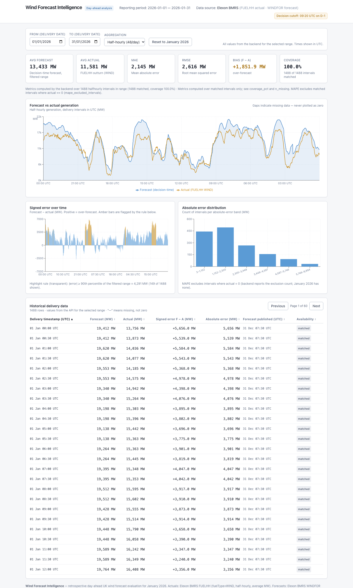

# Wind Forecast Intelligence

Retrospective **day-ahead UK wind forecast vs outturn** analysis for **January 2026**, built on public
Elexon BMRS data. The dashboard answers one question for every half-hour of the month:
*how far off was the day-ahead wind forecast, when was it made, and how reliable was it?*

---

## 1. Problem statement and intended users

**Problem.** System operators, traders and analysts need to know how trustworthy day-ahead wind
forecasts were *at the moment the decision was made* — not with hindsight. Forecast vendors and
published metrics rarely expose which vintage was actually available before the market gate, and
outturn comparisons are usually averaged into opacity.

**Intended users.**

- Energy-market analysts evaluating day-ahead wind forecast quality (GB)
- Trading / scheduling teams reviewing historical bias before a delivery period
- Data/ML practitioners wanting a clean, auditable forecast-vs-actual baseline on real grid data
- Reviewers assessing a complete, testable full-stack data application

## 2. Key features

- **Point-in-time forecast selection** — for each delivery interval the latest WINDFOR vintage
  published **at or before 09:20 UTC on D-1** (EPEX SPOT GB day-ahead order-book closure) is used;
  post-cutoff publications are never used for historical accuracy.
- **Half-hourly and hourly views** — native FUELHH half-hourly actuals; hourly grain averages the
  two half-hours; daily view averages complete days only.
- **Accuracy KPIs** — MAE, RMSE, bias (F − A), MAPE, average forecast vs actual, coverage — always
  shown with matched-interval counts.
- **Error analysis** — signed error over time (positive = over-forecast) with a transparent
  90th-percentile highlight rule, plus absolute-error distribution histogram.
- **Auditable data table** — delivery timestamp, forecast, actual, signed/absolute error, the
  publication time of the selected vintage, and availability status; sortable, paginated.
- **Honest data handling** — missing intervals are gaps or “—”, never zero-filled; coverage and
  status counts are always reported beside metrics.
- **Filtering** — date range and aggregation (half-hourly / hourly / daily) drive charts, table and
  KPIs from the same dataset.

## 3. Screenshots

Actual rendered dashboard (headless Chrome against the running app, real January 2026 API data):



*(Header + filters + KPIs, forecast-vs-actual chart, signed-error chart with p90 flags,
absolute-error histogram, and the first page of the delivery data table.)*

## 4. Technology stack

| Layer | Technology |
|---|---|
| Backend | Python 3.9+ (3.12 in Docker), FastAPI, Pydantic v2, httpx, uvicorn |
| Frontend | React 18, TypeScript 5.6, Vite 5, Tailwind CSS 3.4, Recharts 2 |
| Tests | pytest (backend), Vitest + Testing Library (frontend), gated live-integration test |
| Containers | Docker, Docker Compose, nginx (frontend SPA + same-origin API proxy) |
| Data | Elexon BMRS Insights API — FUELHH (actual), WINDFOR (forecast), keyless |

## 5. Architecture

```
                     ┌──────────────────────────────────────────────┐
                     │ Elexon BMRS API (public, no key)             │
                     │  GET /datasets/FUELHH/stream  (half-hourly)  │
                     │  GET /datasets/WINDFOR/stream (hourly,       │
                     │       8 vintages/day)                        │
                     └───────────────────┬──────────────────────────┘
                                         │ httpx fetch (first request / refresh)
                                         ▼
┌─────────────────────────────┐   ┌──────────────────────────────────────────┐
│ Frontend (React SPA)        │   │ Backend (FastAPI, port 8000)             │
│  KPIs · charts · table      │   │  /health  /api/overview                  │
│  filters → typed fetch      │──▶│  /api/timeseries  /api/accuracy          │
│  client.ts (VITE_API_BASE)  │   │  /api/forecasts/latest                   │
│                             │   │                                          │
│  Docker: nginx serves SPA   │   │  DataStore (in-memory, TTL 3600 s):      │
│  + proxies /api,/health     │   │   dedupe → cutoff selection → align      │
│  (same-origin, no CORS)     │   │   → metrics (matched intervals only)     │
└─────────────────────────────┘   └──────────────────────────────────────────┘
        │                                        ▲
        │  docker compose (local): nginx proxy   │  CORS (direct cross-origin):
        └────────────────────────────────────────┘  ALLOWED_ORIGINS env var
```

Two deployment modes:

- **Docker Compose (local):** browser → nginx (`:8081`) → proxies `/api` + `/health` to the
  backend container (same-origin, no CORS needed).
- **Split hosts (Vercel + API host):** browser calls the backend URL directly across origins;
  `VITE_API_BASE` (build time) points at it and `ALLOWED_ORIGINS` on the backend permits it.

## 6. Repository layout

```
.
├── README.md                  # this file
├── .env.example               # placeholder environment variables (no secrets)
├── .gitignore
├── docker-compose.yml         # local two-container stack (backend + nginx frontend)
├── render.yaml                # Render blueprint for the backend (Docker web service)
├── backend/
│   ├── Dockerfile             # python:3.12-slim + HEALTHCHECK + uvicorn CMD
│   ├── requirements.txt
│   ├── pytest.ini
│   ├── app/
│   │   ├── main.py            # FastAPI app, CORS, ElexonError → 502 handler
│   │   ├── api/routes.py      # all HTTP endpoints (response shapes = schemas.py)
│   │   ├── core/config.py     # env-driven Settings (period, cutoff, TTL, origins)
│   │   ├── models/schemas.py  # public response schemas (Pydantic)
│   │   ├── models/records.py  # internal record types, error = F − A, classify()
│   │   └── services/
│   │       ├── elexon_client.py      # httpx client, retries, ElexonError
│   │       ├── forecast_service.py   # dedupe, cutoff selection, alignment, cache
│   │       └── metrics_service.py    # MAE/RMSE/bias/MAPE over matched only
│   └── tests/                 # 55 tests: contracts, metrics, selection, CORS, …
├── frontend/
│   ├── Dockerfile             # multi-stage: node build → nginx serve + proxy
│   ├── nginx.conf.template    # /api + /health proxy, SPA fallback ($BACKEND_URL)
│   ├── vite.config.ts         # dev proxy :5173 → :8000, vitest config
│   └── src/
│       ├── App.tsx            # state, filters, fetch orchestration, layout
│       ├── api/               # client.ts (typed fetch) + types.ts (schema mirror)
│       ├── components/        # Header, KpiCards, FilterBar, charts, DataTable, States
│       ├── lib/aggregate.ts   # chart points, daily means, p90 rule, formatters
│       ├── integration/live.test.tsx  # opt-in test against a real backend
│       └── test/setup.ts      # jsdom shims (ResizeObserver, layout, fetch signal)
├── scripts/
│   ├── verify_api.py          # Phase-1 live API contract checks (stdlib only)
│   └── fetch_samples.py       # writes verified sample records to data/samples/
├── data/samples/              # small verified API samples + provenance manifest
├── docs/
│   ├── api_findings.md        # verified Elexon contract, cutoff sources, risks
│   └── screenshots/dashboard-full.png
```

## 7. Data sources and Elexon fields

Base URL: `https://data.elexon.co.uk/bmrs/api/v1` (no API key; verified in
[`docs/api_findings.md`](docs/api_findings.md)).

| Dataset | Role | Fields used | Cadence |
|---|---|---|---|
| **FUELHH** | Actual outturn (`fuelType=WIND`) | `settlementDate`, `settlementPeriod` (1–48), `publishTime`, `generation` (MW) | half-hourly, 48/day |
| **WINDFOR** | Day-ahead forecast | `publishTime`, `startTime`, `generation` (MW) | hourly; **8 vintages/day** (02:30, 04:30, 07:30, 09:30, 11:30, 15:30, 18:30, 22:30 UTC) |

Filters used: FUELHH `settlementDateFrom/To` **XOR** `publishDateTimeFrom/To` (mixing → HTTP 400);
WINDFOR publish-time window only (no delivery-date filter). Sample records and provenance:
[`data/samples/`](data/samples/).

## 8. Forecast vintage selection and historical decision cutoff

**Cutoff: 09:20 UTC on D−1** (EPEX SPOT GB day-ahead order-book closure,09:30 GMT = 09:20 UTC in
January; sources recorded in `docs/api_findings.md`). Configurable via `DECISION_CUTOFF_HHMM`.

**Rule (applied independently to every delivery interval):**

1. Eligible vintages for delivery day *D* are those with `publishTime ≤ (D−1 at cutoff, UTC)`.
2. Among eligible vintages that cover the interval, the one with the **maximum `publishTime` wins**.
3. Post-cutoff publications are **never** used for historical accuracy; they are listed separately
   by `/api/forecasts/latest` (`ignored_post_cutoff_publish_times`).

For January 2026 this selects exactly one vintage per day — **D−1 07:30 UTC** for all 31 days
(audited: 0 cutoff violations across 1,488 intervals).

**Grain mapping (documented, no value substitution):**

- Hourly grain: actual = mean of the two half-hourly actuals (requires **both** halves; otherwise
  the interval is unmatched). Forecast = the hourly value.
- Half-hourly grain: the hourly forecast is mapped to **both** half-hours of its clock hour.
- Daily view: mean of a day’s half-hourly rows, emitted only when **every** row is present.

## 9. Accuracy metrics and sign conventions

Computed by the backend **over matched intervals only** (both forecast and actual present):

| Metric | Definition |
|---|---|
| MAE | mean(\|F − A\|) over matched intervals |
| RMSE | √( mean( (F − A)² ) ) over the **same** matched intervals |
| **Bias** | mean(**F − A**) — **positive = over-forecast**, negative = under-forecast |
| MAPE | mean( \|F − A\| / \|A\| ) × 100; intervals with **A = 0** are excluded and counted in `mape_excluded_intervals` |
| Coverage | `n_matched / n_expected` — always reported; `coverage_complete` only when 100 % |
| Status counts | `matched`, `forecast_only`, `actual_only`, `missing_both` |

`error_mw` on every row is **F − A**. When nothing matches, metrics are `null`, never `0`.
The error charts flag `|error| ≥ p90(|error|)` of the current range as a transparent “large error”
rule (amber), with the threshold printed under the chart.

## 10. Data quality, coverage and limitations (January 2026)

Independently audited against the live API (Phase 4):

| Check | Result |
|---|---|
| Expected half-hourly intervals (31 × 48) | **1,488** |
| FUELHH rows fetched / served | **1,488 / 1,488** (0 nulls) |
| WINDFOR rows fetched | **18,688 rows, 256 vintages** → 7,512 eligible (≤ cutoff) → **744 winners** → 1,488 mapped values |
| Matched intervals | **1,488 / 1,488** (hourly: 744 / 744) |
| Missing intervals | **0 (0.00 %)** — coverage 100 % |
| Duplicate records | **0 dropped**; served grid unique1,488 / 1,488 |
| Headline metrics | hourly MAE **2,142.120** RMSE **2,611.695** bias **+1,851.904** · half-hourly MAE **2,145.166** RMSE **2,615.812** MAPE **22.44 %** |

**Assumptions (labelled in the UI footer and API notes):**

- **Units:** FUELHH is documented as MW; **WINDFOR units are undocumented upstream — MW assumed**.
- All timestamps are **UTC** (`Z`-suffixed); the UI formats with UTC getters only.
- Hourly→half-hourly forecast mapping as described above (doubles rows, does not change values).
- The backend never zero-fills: gaps stay `null` and render as chart gaps or “—”.

## 11. Local prerequisites

- **Python 3.9+** (tested 3.9.6 locally; Docker image uses 3.12)
- **Node.js ≥ 18** (tested 24.x) and npm
- **Docker + Docker Compose** (optional — for the containerized stack)
- Network access to `data.elexon.co.uk` (first data load ~4–6 s, then cached for 1 h)

## 12. Installation and startup (no Docker)

```bash
# Backend (terminal 1)
python3 -m venv .venv
.venv/bin/pip install -r backend/requirements.txt
cd backend && ../.venv/bin/uvicorn app.main:app --port 8000
# → http://127.0.0.1:8000/health

# Frontend (terminal 2) — dev server proxies /api + /health to :8000
cd frontend
npm install
npm run dev
# → http://localhost:5173
```

## 13. Docker and Docker Compose

```bash
docker compose up --build
# Frontend (nginx + API proxy): http://localhost:8081
# Backend (direct):             http://localhost:8000/health
```

- The backend container has a `HEALTHCHECK` on `/health`; compose waits for
  `service_healthy` before starting the frontend.
- The frontend nginx proxies `/api/*` and `/health` to `http://backend:8000`
  (`BACKEND_URL` env), so the browser stays same-origin — no CORS needed in Docker.
- Standalone images: `docker build -t wind-api ./backend`,
  `docker build --build-arg VITE_API_BASE=https://api.example.com -t wind-web ./frontend`.
- Port note: the compose frontend uses **8081** (8080 is commonly taken by local proxies);
  change `docker-compose.yml` if you prefer 8080.

## 14. Environment variables

Copy `.env.example` → `.env` (never commit `.env`). **No API secrets exist** — Elexon is keyless.

| Variable | Default | Purpose |
|---|---|---|
| `ELEXON_BASE_URL` | `https://data.elexon.co.uk/bmrs/api/v1` | Upstream API root |
| `PERIOD_START` / `PERIOD_END` | `2026-01-01` / `2026-01-31` | Reporting period (delivery dates) |
| `DECISION_CUTOFF_HHMM` | `09:20` | Historical decision cutoff on D−1, UTC |
| `CACHE_TTL_SECONDS` | `3600` | In-memory dataset TTL |
| `ELEXON_TIMEOUT_SECONDS` / `ELEXON_RETRIES` | `60` / `3` | Upstream HTTP behaviour |
| `ALLOWED_ORIGINS` | `http://localhost:5173,…` | Comma-separated CORS origins (add your Vercel URL) |
| `VITE_API_BASE` | `""` | **Build-time** frontend API base; `""` = same-origin (Docker/dev proxy), set to the public backend URL for Vercel |
| `BACKEND_URL` | `http://backend:8000` | nginx proxy upstream inside the frontend container |

## 15. Backend API endpoints

All responses are JSON; errors are `{"detail": "…"}` (400 validation, 422 schema, 502 upstream).

| Method | Path | Description |
|---|---|---|
| GET | `/health` | Liveness, period, cutoff label, cache state (never calls upstream) |
| GET | `/api/overview` | Headline stats at both grains + selected vintage audit list |
| GET | `/api/timeseries?start&end&grain` | Aligned rows: `halfhourly` (48/day) or `hourly` (24/day) |
| GET | `/api/accuracy?start&end&grain` | Metrics over matched intervals + coverage/status counts |
| GET | `/api/forecasts/latest?delivery_date` | Eligible-at-cutoff vintage for a day + ignored post-cutoff ones |

```bash
curl "http://127.0.0.1:8000/health"
curl "http://127.0.0.1:8000/api/overview"
curl "http://127.0.0.1:8000/api/timeseries?start=2026-01-01&end=2026-01-07&grain=halfhourly"
curl "http://127.0.0.1:8000/api/accuracy?start=2026-01-01&end=2026-01-31&grain=halfhourly"
curl "http://127.0.0.1:8000/api/forecasts/latest?delivery_date=2026-01-15"
# force a dataset reload: append &refresh=true to any data endpoint
```

## 16. Tests

```bash
# Backend — 55 tests (contracts, metrics, selection rule, alignment, CORS, errors)
cd backend && ../.venv/bin/python -m pytest

# Frontend — 16 tests (loading/error states, KPI rendering, filters, aggregation, pure funcs)
cd frontend && npm test

# Opt-in live integration test against a real running backend (17th test)
cd frontend && LIVE=1 VITE_API_BASE=http://127.0.0.1:8000 npm test

# Upstream contract verification (stdlib only, hits the real Elexon API)
python3 scripts/verify_api.py
```

Latest run: backend **55 passed**, frontend **16 passed + 1 gated**, live mode **17 passed**,
`tsc --noEmit` and `npm run build` clean, pyflakes clean.

## 17. Deployment status and URLs

> **Status: not yet deployed — no live URLs to report.** Deployment requires account
> credentials that were not available during preparation. Everything needed is in the repo:

- **Frontend → Vercel** (static SPA):
  ```bash
  npm install -g vercel
  cd frontend && vercel --prod
  # set project env var at build time: VITE_API_BASE=https://<backend-public-url>
  ```
- **Backend → Render** (free web tier, no credit card; Docker-native — [`render.yaml`](render.yaml)):
  Dashboard → New → Blueprint → this repo. Then set
  `ALLOWED_ORIGINS=https://<your-vercel-domain>.vercel.app`.
- **Why separate hosts:** the frontend is a static bundle (ideal for Vercel’s CDN) while the
  backend needs a long-running process to keep its in-memory dataset cache — serverless
  functions would re-fetch ~20k upstream rows on every cold start. Heroku was evaluated but has
  no free tier (credit card + paid dyno required).

**Once deployed, verify:** `GET https://<backend>/health` returns 200; the frontend URL loads;
the dashboard renders real KPIs (same-origin or CORS path); no console errors.

## 18. AI tools used

Development was performed with **opencode**, an open-source AI coding agent (model:
`opencode/mimo-v2.6-flash-free`), under continuous human direction:

- **Phase 1** — reverse-engineered the JS-only Elexon docs from the OpenAPI spec; wrote and ran
  `scripts/verify_api.py` to verify schemas, filters, cadence and the cutoff rule against the
  live API; produced `docs/api_findings.md`.
- **Phase 2** — implemented the FastAPI backend (routes, services, schemas) and its 51-test suite;
  live-verified every endpoint.
- **Phase 3** — implemented the React dashboard (charts, table, filters, states) and its tests.
- **Phase 4** — audited the integration end-to-end: independently recomputed all metrics, verified
  the cutoff on every interval, found and fixed the wildcard-CORS issue, and added CORS tests.
- **Phase 5/6** — containerization (Dockerfiles, compose, nginx proxy, health checks),
  deployment blueprints, and this README.

Human decisions that shaped the build: the 09:20 UTC cutoff choice, phase-gated scope, platform
choices, and approval of every phase’s acceptance. AI-generated code was reviewed, tested and
audited before acceptance; all numbers quoted here come from the automated tests and audit scripts
in this repository.

## 19. Known limitations and possible future improvements

**Limitations**

- **Deployment pending** — no public URLs yet (see §17); local/Docker verification is complete.
- **Chart tick labels** show UTC time-of-day only; across multi-week ranges consecutive ticks fall
  ~4 days apart, so labels appear to “descend” (data and tooltips are correct and dated).
- **Single period, in-memory cache** — one dataset per process (TTL 1 h); a restart re-fetches.
- **WINDFOR units are an assumption** (MW) — Elexon does not document them.
- **No user-facing persistence** — nothing is stored beyond process memory; no database.
- Free hosting tiers sleep when idle (first request after idle is slower).

**Future improvements**

- Complete the Vercel + Render deployment (blueprint and CLI steps are ready).
- Add date/timezone pickers, multi-month ranges, and per-day vintage comparison views.
- Persist the dataset (SQLite/Parquet) and add scheduled refresh instead of lazy TTL.
- Benchmark additional decision cutoffs; add forecast-error decomposition (ramp vs level).
- CI pipeline (pytest + vitest + docker build) on push.

---

*Data © Elexon / National Grid ESO via the public BMRS API. This project is an independent
analysis tool and is not affiliated with Elexon or EPEX SPOT.*
